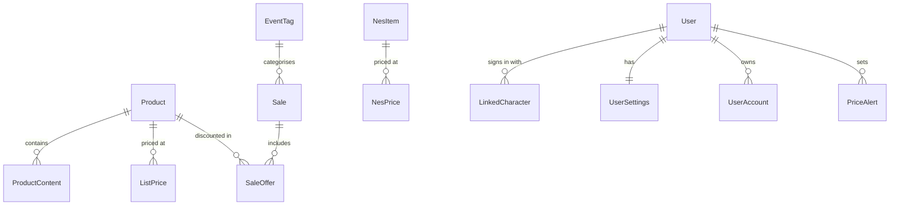

# FCSalesTool — Project Plan

An EVE Online **subscription specials tracker**: record every special CCP runs (what, how much, when it starts and ends), predict when the next one will be, and give each user dashboards that tell them **what to buy and when**.

Status: planning · Last updated: 2026-11-21

---

## 1. Goals

1. **Record specials** — a clean history of Omega, PLEX, bundle, and skillpoint offers, with list prices and sale prices over time.
2. **Predict sales** — estimate when the next sale for each product type is likely, and how deep the discount will be.
3. **Subscription Planner** — given a number of accounts and/or a maximum one-time spend, compute the cheapest set of purchases (Omega subs, PLEX packs, sub + PLEX bundles, Omega via PLEX on the New Eden Store).
4. **Skillpoint Planner** — compare the cost per SP across all sources and say whether now is a good time to buy.

### Non-goals (v1)

- Scraping CCP's store or news (fragile, possibly against ToS).
- Crowdsourced data entry.
- Automatic currency conversion.
- Price-forecasting ML models (not enough data yet).

---

## 2. Decisions

| Topic | Decision |
|---|---|
| Relationship to other projects | Standalone (no shared code with `NewEdenSoft.Hunters`) |
| Data entry | **Admin only**, via a protected admin area |
| Audience | **Public, multi-user** site |
| Authentication | **Local accounts** (ASP.NET Core Identity): sign in with **EVE SSO** and/or a **confirmed email + password**; `Admin` role for data entry (see 7.1) |
| Frontend | **React 19 + TypeScript** SPA (Vite), **Tailwind CSS v4**, **TanStack Router**, **TanStack Query** (see 2.1) |
| Backend | **.NET 10**, ASP.NET Core **Web API** (minimal APIs, OpenAPI) |
| Persistence | EF Core; **PostgreSQL** (SQLite for local dev) |
| Currencies | **EUR and USD**; every price stored as `(amount, currency)` |

### 2.1 Frontend architecture

**Why not Blazor Server:** its SignalR circuit makes every interaction a server round trip and loses UI state on disconnect — poor for users with high latency. A client-side SPA keeps the UI responsive and only calls the server for data.

- **React 19 + TypeScript**, built with **Vite**.
- **Tailwind CSS v4** via the `@tailwindcss/vite` plugin; design tokens in CSS (`@theme`), no `tailwind.config.js`.
- **TanStack Router** with file-based routes (`@tanstack/router-plugin`), fully type-safe params and search params. Planner inputs live in **search params**, so a plan is a shareable/bookmarkable URL.
- **TanStack Query** for all server state. Route `loader`s call `queryClient.ensureQueryData(...)` so data starts loading on navigation; components read it with `useSuspenseQuery`.
- **Typed API client generated from the backend's OpenAPI document** (e.g. `@hey-api/openapi-ts` or `openapi-typescript` + `openapi-fetch`), so C# DTO changes surface as TypeScript errors.
- **Planner recalculation:** inputs are debounced (~300 ms) and the result is a query keyed on the inputs (`placeholderData: keepPreviousData`), so the previous result stays on screen while the next one loads — one plain HTTP request per change, no persistent connection.

**Hosting shape:** one deployable. ASP.NET Core serves the built SPA from `wwwroot` with a fallback to `index.html`, and the API under `/api`. Same origin means cookie auth with no CORS. In development, Vite's dev server proxies `/api` and `/auth` to the ASP.NET Core app.

### 2.2 Currency handling

CCP currently charges the same amount regardless of currency (e.g. 14.95 USD = 14.95 EUR). We still store each price per currency so that a regional price change later is a data change, not a schema change.

- The admin entry form takes one amount and **pre-fills it for both currencies**; either can be overridden.
- Users choose their currency in settings; planners and predictions use only prices in that currency.
- `Currency` is an enum/lookup (`EUR`, `USD`), so adding one later is trivial.

---

## 3. Domain model

### 3.1 Entities

| Entity | Purpose | Key fields |
|---|---|---|
| **Product** | Something CCP sells for real money | `Id`, `Name`, `Kind` (OmegaSub, PlexPack, Bundle, SkillPointPack, StarterPack, Other), `IsActive`, `PurchaseLimitPerAccount?` (starter packs are one per account) |
| **ProductContent** | What a product contains (a bundle has several rows) | `ProductId`, `ContentType` (OmegaDays, Plex, SkillPoints, Mct, SkillExtractor, Accelerator, Cosmetic, Other), `Quantity`; accelerators also store attribute bonus and duration so their SP can be derived (see 3.3) |
| **ListPrice** | Regular (non-sale) price, valid over a date range | `ProductId`, `Currency`, `Amount`, `ValidFrom`, `ValidTo?` |
| **Sale** | A special/promotion event | `Id`, `Title`, `StartsAt`, `EndsAt`, `StartIsApproximate`, `EndIsApproximate`, `EventTag?`, `SourceUrl?`, `Notes`, `Screenshot?` (deferred to phase 5) |
| **SaleOffer** | One discounted product within a sale | `SaleId`, `ProductId`, `Currency`, `SaleAmount`, `BonusContent?` (e.g. +10% PLEX) |
| **EventTag** | Recurring event category used for prediction | `Name` (BlackFriday, Christmas, Anniversary, Summer, Fanfest, Other), `TypicalMonth?` |
| **NesItem** | An item on the New Eden Store priced in PLEX | `Id`, `Name`, `Kind` (OmegaViaPlex, SkillInjector, Mct, …), `ContentType`, `Quantity` |
| **NesPrice** | PLEX price of a NES item over time (incl. NES sales) | `NesItemId`, `PlexCost`, `ValidFrom`, `ValidTo?`, `IsSale` |
| **MarketPrice** | ISK price snapshot (PLEX, extractors, injectors, Hypercore) | `TypeId`, `Date`, `BuyPrice`, `SellPrice`, `Volume?`, `Source` (Esi, Manual — backfilled values are Manual) |
| **User** (`AppUser`) | Local account (Identity) | `Id`, `DisplayName`, `Email?`, `EmailConfirmed`, `PasswordHash?`, `AvatarCharacterId?`, `CreatedAt` |
| **LinkedCharacter** | EVE character that signs in to an account | `CharacterId` (PK), `UserId`, `Name`, `OwnerHash?`, `LinkedAt`, `LastSignInAt?` |
| **UserSettings** | Per-user planner inputs | `Currency`, `AccountCount`, `PlanHorizonMonths`, `MaxOneTimeSpend?`, `PlexOnHand`, alert preferences |
| **UserAccount** *(optional)* | Each of the user's EVE accounts | `Label`, `OmegaExpiresAt?`, `CharacterSp?` (for injector tiers) |
| **PriceAlert** | "Notify me when X drops below Y" | `UserId`, `Metric`, `Threshold`, `Currency` |

### 3.2 Entity relationships



### 3.3 Normalised unit costs

Everything is reduced to comparable **unit costs**, computed per currency at a given date:

- **Cost per Omega-day** (direct subs and bundles)
- **Cost per PLEX** (PLEX packs and bundles)
- **Cost per 100k SP** (SP packs, accelerators, NES injectors via PLEX, market injectors via ISK → PLEX)

Accelerator SP = attribute bonus × duration, which depends on the character's Biology skill; we assume Biology 5 by default (configurable), as the backfill sheet does.

For bundles, the cost is split across their contents using the current list-price unit costs as weights, so a bundle's "effective Omega cost" and "effective PLEX cost" can be shown.

The **effective price** of a product on a date is its `SaleOffer` price if a sale is active, otherwise its `ListPrice`.

---

## 4. Sale prediction

Start simple and explainable; the dataset will be small for a long time.

### 4.1 Seasonal recurrence (primary)

CCP repeats sales around the same events every year. For each `EventTag` × product kind:

- Expected window = the historical start/end day-of-year ± spread.
- Expected discount = median (and range) of past discounts.
- Confidence = how many of the past N years the event happened (e.g. "3 of 3 years").

### 4.2 Interval statistics (secondary)

For each product kind, take the gaps between consecutive sales:

- Mean gap and standard deviation → probability of a sale within the next X days.
- Covers sales that aren't tied to a named event.

### 4.3 Output

- Per product kind: *"Next likely 12-month Omega sale: 27 Nov – 2 Dec · high confidence (3/3 years) · typical discount 30–40%."*
- An **upcoming sales calendar** combining both methods.
- Predictions are recomputed whenever a sale is recorded, and nightly.

### 4.4 Bootstrapping

Predictions are only as good as the history. **Backfill past sales** during phase 1.

**Source:** a public [Google Sheet](https://docs.google.com/spreadsheets/d/1K2CEaO4P3hhAZFMcLy8_E4wtm_QHG8tQlsylVHvANgA) with ~42 store snapshots from Feb 2023 to Nov 2026 — one tab per snapshot with USD store prices, NES PLEX prices, "sale" flags, free-text notes (sale end dates), and ISK market prices for PLEX, extractors, large injectors and Hypercore.

**Approach** (tracked in #13): tab layouts drift, so a one-off extraction script (`tools/backfill/`) produces draft JSON per tab; humans curate it into `data/backfill/*.json`; the admin bulk import loads it. Dates found in notes are exact; dates inferred only from snapshot dates are flagged approximate, so prediction can weigh them accordingly.

**Permission:** the sheet is third-party work. Permission and attribution must be agreed before backfilled data is shown publicly (#31).

---

## 5. Dashboard 1 — Subscription Planner

### 5.1 Inputs (from user settings, editable on the page)

- Number of accounts, and/or per-account Omega expiry dates
- Planning horizon (months of Omega needed per account)
- Optional maximum one-time spend
- Currency
- PLEX already on hand

### 5.2 Optimisation model

A small integer linear program (Google OR-Tools CP-SAT, or exhaustive search — the space is tiny).

**Offers** `o` are every product available today at its effective price `c_o`, with contents `days_o` (Omega days, bound to the account it is applied to) and `plex_o` (pooled).

**Variables**

- `x[o,a]` — integer, number of account-bound offer `o` applied to account `a`
- `y[o]` — integer, number of PLEX-only offer `o` bought
- `z[a]` — integer, number of NES "Omega via PLEX" redemptions on account `a`

**Constraints**

- Coverage, per account: `Σ_o days_o · x[o,a] + nesOmegaDays · z[a] ≥ requiredDays[a]`
- PLEX balance: `plexOnHand + Σ plex_o · (Σ_a x[o,a] + y[o]) ≥ nesOmegaPlexCost · Σ_a z[a]`
- Budget (if set): `Σ c_o · (Σ_a x[o,a] + y[o]) ≤ maxSpend`

**Objective**

- No budget: minimise total cost.
- With budget: maximise covered account-days (tie-break on lower cost).

### 5.3 Outputs

- A **shopping list per account** (what to buy and where to apply it)
- Total cost, cost per account-month, and saving vs. list price
- **Buy now or wait?** — compares today's best plan with the plan at predicted next-sale prices, and flags whether current Omega expiries run out before that sale

### 5.4 Open modelling questions

- Should moving PLEX between accounts carry a cost (market tax/fees) or be treated as free?
- When waiting is better but an account would lapse first, should the planner suggest a short bridging sub?

---

## 6. Dashboard 2 — Skillpoint Planner

### 6.1 Inputs

- Target SP or a budget
- Currency, optional ISK budget
- Optionally the character's current SP (injector tiers depend on it)

### 6.2 Sources compared

| Source | Paid in | Conversion |
|---|---|---|
| SP packs (account store) | EUR/USD | direct |
| NES skill injectors | PLEX | PLEX → EUR/USD via best current PLEX unit cost |
| Market skill injectors | ISK | ISK → PLEX via ESI PLEX price → EUR/USD |

Large skill injectors yield fewer SP the more SP the character has (diminishing-returns tiers). The planner applies the tier for the entered character SP. *(Tier values to be confirmed against current game rules and stored as config, not hard-coded.)*

### 6.3 Outputs

- Cost per 100k SP per source, cheapest highlighted
- Current price vs. historical **low / median** → "good time to buy" indicator
- Next predicted SP sale (from section 4)

---

## 7. Users, settings, and alerts

- **Login:** EVE SSO or email + password. Accounts are local; EVE SSO only proves which character you are. No ESI scopes, and **no EVE tokens are stored**.
- **Roles:** `User` (default), `Admin` (data entry). The first admin is seeded from config by character ID.

### 7.1 Auth implementation

*Decided 2026-11-21: local email/password accounts are required, so we use ASP.NET Core Identity (password hashing, email tokens, lockout) instead of cookie + OAuth only.*

- **Identity** (`AddIdentityCore<AppUser>` + EF stores + `SignInManager`), cookie auth (`ow.auth`, HttpOnly, SameSite=Lax, Secure outside dev, 14-day sliding). Data-protection keys are stored in the database.
- **Accounts:** an account has an optional email + password and any number of **linked EVE characters**. Display name defaults to the character name (EVE sign-up) or the email address, and can be changed. The avatar is the portrait of a chosen linked character, else initials.
- **Email + password:** register → confirmation email → sign in (`RequireConfirmedEmail`). Passwords: min 10 characters, no composition rules; lockout after 5 failures for 15 min. Forgot/reset password by email (a reset also confirms the address). Register / forgot / resend never reveal whether an email has an account; registering an existing address emails its owner instead.
- **EVE SSO:** OAuth handler (`/auth/eve/login`, callback `/auth/eve/callback`). The access token (JWT) is validated against the SSO's JWKS (issuer, both audiences, lifetime) and then discarded. The first sign-in with an unknown character creates an account; later sign-ins find it via `LinkedCharacter`. A signed-in user links more characters with `/auth/eve/link`. A character belongs to one account; if its `owner` hash changes (character transferred), it is detached from the old account.
- **Account safety:** a character can't be unlinked if it is the account's only way to sign in (no password + confirmed email). Email changes take effect only after the new address is confirmed.
- **Endpoints:** `/api/auth/{register,login,logout,confirm-email,confirm-email-change,resend-confirmation,forgot-password,reset-password,providers}`; `/api/me` (GET, PATCH display name), `/api/me/avatar`, `/api/me/characters/{id}` (DELETE), `/api/me/password`, `/api/me/email`. Anonymous auth endpoints are rate-limited per IP.
- **BFF pattern:** the server does the whole OAuth flow; no tokens in the browser. Unauthenticated API calls return **401, not a redirect**.
- **CSRF:** SameSite=Lax cookies + a required `X-Requested-With` header on state-changing `/api` and `/auth` requests.
- **Email links** use `App:PublicBaseUrl` (required outside Development, so a forged `Host` header can't redirect reset links). Dev mail goes to a Mailpit container.
- **Roles from the database:** `Admin` (not built yet) — an `IClaimsTransformation` or claims at sign-in, first admin seeded from config.
- **Frontend:** `/api/me` is a TanStack Query query (`null` when signed out); protected routes check it in `beforeLoad` and redirect to `/login?redirect=…`. Hiding admin UI is only for convenience — the API enforces access.
- **Settings** drive both dashboards; anonymous visitors see the dashboards with default settings.
- **Alerts** (phase 5): email or Discord webhook when a sale starts or a unit cost drops below a threshold.

---

## 8. Architecture

```
FCSalesTool.slnx
aspire.config.json
├─ src/
│  ├─ FCSalesTool.Domain          # entities, value objects (Money, Currency), enums
│  ├─ FCSalesTool.Application     # pricing/unit-cost, planners, prediction, use cases
│  ├─ FCSalesTool.Infrastructure  # EF Core DbContext, migrations, ESI client, jobs
│  ├─ FCSalesTool.Api             # minimal API endpoints, EVE SSO (BFF), serves SPA
│  ├─ FCSalesTool.AppHost         # Aspire AppHost: orchestrates postgres, api, web for local dev
│  └─ FCSalesTool.ServiceDefaults # OpenTelemetry, health checks, service discovery
├─ web/                                # React 19 + TS SPA (Vite, pnpm)
│  ├─ src/routes/                      # TanStack Router file-based routes
│  ├─ src/features/                    # planner/, skillpoints/, sales/, admin/, settings/
│  ├─ src/components/                  # shared UI (MoneyDisplay, SaleBadge, …)
│  ├─ src/api/                         # generated OpenAPI client + query option factories
│  └─ src/styles/app.css               # Tailwind v4 entry + @theme tokens
└─ tests/
   ├─ FCSalesTool.Domain.Tests
   ├─ FCSalesTool.Application.Tests   # planner + prediction tests (most value here)
   └─ FCSalesTool.Api.Tests           # endpoint tests via WebApplicationFactory
```

Frontend tests: **Vitest + React Testing Library** for components, **MSW** to mock the API; optionally **Playwright** for a few end-to-end flows (login stubbed).

- **Money:** a `Money(decimal Amount, Currency Currency)` value object (EF Core complex type); arithmetic across currencies throws.
- **DbContext:** the normal scoped-per-request `DbContext` (fine for a Web API). Background jobs create their own scope.
- **API style:** minimal API endpoint groups (`/api/sales`, `/api/products`, `/api/planner/...`, `/api/admin/...`), DTOs separate from entities, `ProblemDetails` for errors, OpenAPI document generated at build for the TypeScript client.
- **Indexes:** `Sale(StartsAt, EndsAt)`, `SaleOffer(ProductId, Currency)`, `ListPrice(ProductId, Currency, ValidFrom)`, `NesPrice(NesItemId, ValidFrom)`, `MarketPrice(TypeId, Date)` — these back the "effective price on date" and history queries.
- **Time:** inject `TimeProvider` everywhere "now" matters (effective prices, predictions, buy-now-or-wait). No `DateTime.UtcNow` in domain/application code, so planner and prediction tests are deterministic.
- **Planners and prediction are pure services** in `Application` (inputs in, result out, no DB access inside the algorithm). This is where most tests go.
- **Project conventions:** an `AGENTS.md` at the repo root covering both halves (API conventions, frontend folder layout, how to regenerate the API client, how to run dev).
- **Background jobs** (hosted services or Hangfire): ESI market price polling (daily), prediction recompute (nightly + on sale change), alert dispatch.
- **ESI:** public market endpoints only; respect cache headers and the user agent rules.
- **Local orchestration:** .NET Aspire (AppHost) runs Postgres (persistent container), the API, and the Vite dev server with service discovery and the Aspire dashboard for logs/traces.
- **Hosting:** TBD (see open questions). Aspire can publish to Docker Compose, Azure Container Apps, or Kubernetes, which keeps the target open.

---

## 9. UI component plans

State rules:

- **Server state** (sales, prices, plans, predictions, `/api/me`) lives only in **TanStack Query**. Query keys and `queryOptions(...)` factories live in `src/api/`, one file per resource, shared by loaders and components.
- **Shareable UI state** (planner inputs, filters, selected currency) lives in **TanStack Router search params**, validated with a schema (e.g. Zod) in the route's `validateSearch`.
- **Local UI state** (open panels, form drafts) is plain `useState`.
- **Global client state**, when it is needed, uses **Zustand** — no other global state library. Never copy server data into Zustand; that stays in TanStack Query.
- **Browser-stored app settings** (e.g. theme, currency/planner defaults for anonymous visitors, dismissed banners) use a **Zustand store with the `persist` middleware** (localStorage). Each persisted store sets a unique `name`, a `version` with a `migrate` function, and `partialize` so only settings (not actions or transient state) are saved. Settings for logged-in users that must follow them across devices belong in the server-side `UserSettings` instead.
- Pages (route components) read data and pass it to presentational components as props; components report changes through callback props.

### 9.1 Subscription Planner (`/planner/subscription`)

```
SubscriptionPlannerPage      (reads search params → debounced usePlanQuery)
├── PlannerInputPanel        (accounts, horizon, max spend, currency, PLEX on hand)
├── PlanSummaryCard          (total cost, cost per account-month, saving vs list)
├── BuyNowOrWaitBanner       (today's plan vs predicted-sale plan, lapse warnings)
└── AccountPlanList
    └── AccountPlanCard      (shopping list for one account)
```

Flow: `PlannerInputPanel` → `onChange` → `navigate({ search })` → debounced input → `POST /api/planner/subscription` via TanStack Query → result passed down. Defaults come from `UserSettings` (or anonymous defaults); edits on the page don't save unless the user chooses to.

### 9.2 Skillpoint Planner (`/planner/skillpoints`)

```
SkillpointPlannerPage        (owns: SpInput, SourceComparison, history stats)
├── SpInputPanel             (target SP or budget, character SP, currency)
├── SpSourceTable            (cost per 100k SP per source, cheapest highlighted)
│   └── SpSourceRow
├── BuyTimingIndicator       (current vs historical low/median)
└── NextSaleCard             (next predicted SP sale)
```

### 9.3 Shared components

`MoneyDisplay`, `SaleBadge` (active / upcoming), `ConfidencePill` (prediction confidence) — reused on history, calendar, and both planners.

## 10. Roadmap

Each phase is a GitHub milestone; each feature is a parent issue with one sub-issue per PR (see CONTRIBUTING.md §2). Issue dependencies are set as "blocked by" links.

### Phase 1 — Foundation and data (`v0.1`)

- Done: solution skeleton, Aspire AppHost, home page, local accounts with EVE SSO and email (#1–#8)
- Foundation (#9): CI, generated TypeScript API client, SPA served from `wwwroot`
- Domain model (#10): `Money`, product catalogue, sales and event tags, NES, market prices
- Admin data entry (#11): Admin role, products, list prices, sales + offers, NES prices
- Public sales pages (#12): current active sales, sales history
- Seed and backfill (#13): bulk JSON import, extraction script, curated catalogue and 2023–2026 history, ISK market history, data permission

### Phase 2 — Subscription Planner (`v0.2`, #38)

- Decisions: PLEX transfer cost and solver (#39), third-party retailer discount (#40)
- Unit-cost service, optimiser (min-cost and budget modes), per-account expiry dates
- Planner API, user settings page, planner dashboard with per-account shopping list

### Phase 3 — Prediction (`v0.3`, #49)

- Event-tag recurrence + interval statistics (aware of approximate dates)
- Upcoming sales calendar
- "Buy now or wait?" in the Subscription Planner

### Phase 4 — Skillpoint Planner (`v0.4`, #50)

- ESI market price polling (PLEX, injectors)
- Injector tier config
- SP dashboard with cost-per-SP comparison and "good time to buy"

### Phase 5 — Polish (`v0.5`, #51)

- Price alerts (email/Discord)
- Price history charts
- Sale screenshots
- Public API / export (optional)

### Launch (`v1.0`, #52)

- Hosting, deploy pipeline, production config, legal and attribution pages, monitoring

Phases 3–5 and launch are single parent issues for now; they are broken down when the previous phase is underway.

---

## 11. Open questions

1. **PLEX transfer cost** — treat moving PLEX between accounts as free, or include fees? → #39
2. **Bridging subs** — should "wait" recommendations include a short sub to avoid lapses? → #49
3. **Hosting** — Azure, VPS, other? Affects database, job setup and file storage. → #52
4. ~~**Historical data**~~ — resolved: backfill from the snapshot sheet (§4.4); permission pending (#31).
5. **Catalogue check** — seed from the Nov 2026 snapshot and spot-check against the live store (#33); injector tiers in phase 4.
6. ~~**.NET test framework**~~ — resolved: xUnit v3 on Microsoft.Testing.Platform.
7. **Frontend extras** — component primitives (shadcn/ui on Tailwind v4, or hand-rolled), forms (TanStack Form fits the stack; React Hook Form is the alternative), charts (Recharts or similar). Package manager: pnpm.
8. **Third-party retailer discount** — model the ~3% creator-code discount as a purchase channel? → #40

## 12. Assumptions

- Prices are as entered by admins; no automatic conversion between currencies.
- The product catalogue is data, not code: CCP changes it, admins update it.
- Omega time from a direct subscription is bound to the account it is purchased on; PLEX is transferable between accounts.
